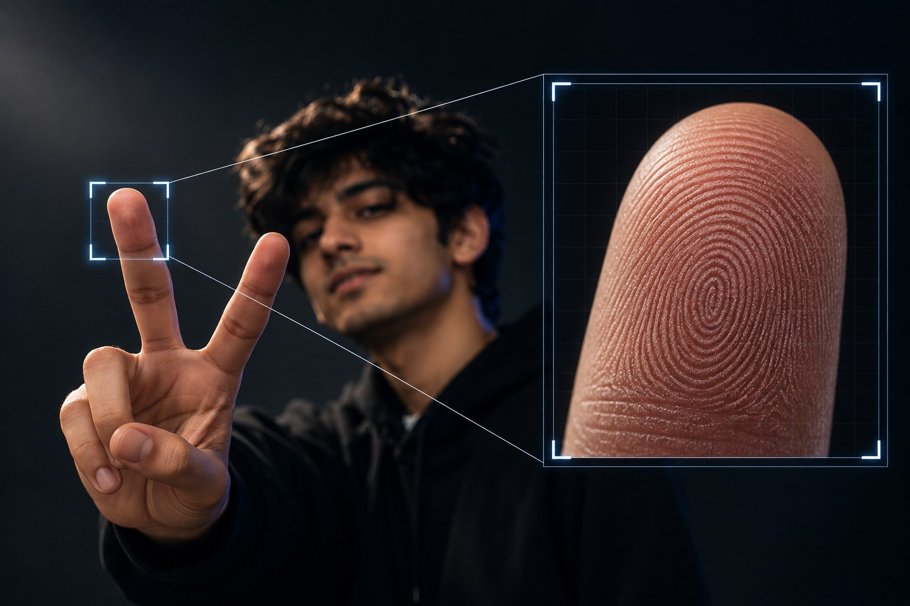
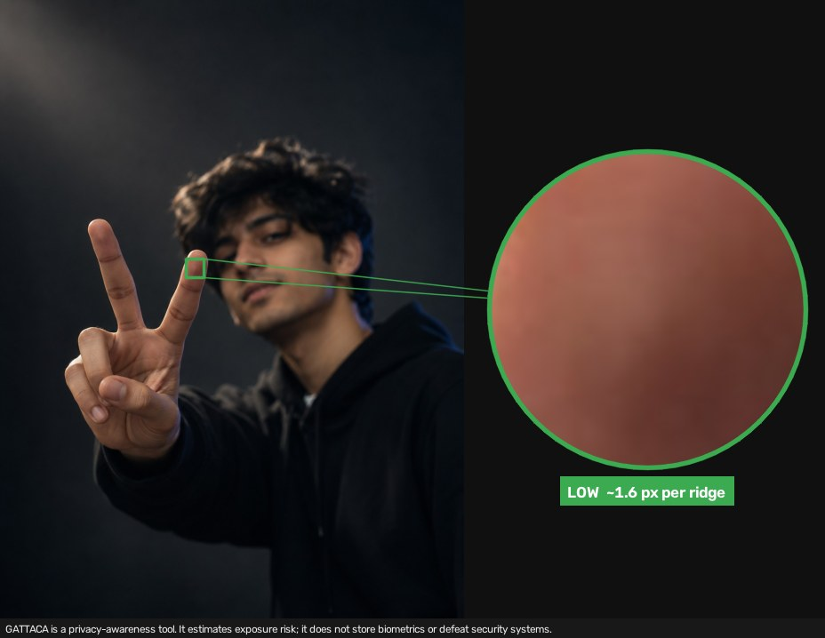
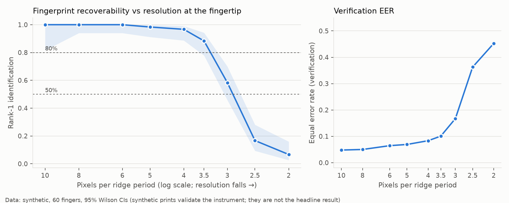
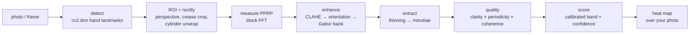

<div align="center">

# GATTACA

**How much of your fingerprint does that photo give away? We measured it.**

[](https://github.com/akshitag001/gattaca/actions/workflows/tests.yml)


OpenCV AI Competition 2026 · powered by AWS

</div>

> GATTACA is a privacy-awareness tool. It estimates exposure risk; it does not store biometrics or defeat security systems.

### For judges

| | |
|---|---|
| **Live endpoint (AWS EC2)** | **http://16.176.2.43:8000** · health check: [`/health`](http://16.176.2.43:8000/health) |
| **Technical report** | [`docs/technical_report.md`](docs/technical_report.md) |
| **Architecture diagrams** | [`docs/architecture.md`](docs/architecture.md) |
| **Agentic Vision evidence** | trace + human-control tests: [How it works → The agent](#the-agent-agentic-vision), [`tests/test_video_agent.py`](tests/test_video_agent.py) |
| **Run it locally** | [Quickstart](#quickstart): 4 commands, 43 tests |

---

## The problem

News outlets and viral posts warn that a peace-sign selfie can leak your fingerprint "from 1.5 metres." None of them give a methodology, and the most-shared example illustrates the claim with an image that is itself captioned *"AI-generated."*

GATTACA replaces the folklore with a measurement. Upload a photo or clip of **your own hand** and it tells you:

| Output | What you get |
|---|---|
| **Risk band** | `HIGH` / `MEDIUM` / `LOW`, with a calibrated probability and a bootstrap confidence |
| **Where** | a heat map of the skin where ridge detail is genuinely recoverable |
| **Why** | the limiting factor (resolution, blur, lighting, coverage) and an equivalent camera distance |
| **Fix** | a one-click protected copy, re-scored to prove the risk dropped |

<table>
<tr>
<td width="50%"></td>
<td width="50%"></td>
</tr>
<tr>
<td><b>The claim.</b> An AI-generated "recovered" whorl, made the way viral posts make them. The ridges are painted by an image model.</td>
<td><b>The measurement.</b> The same pose, a real photo, the real pipeline. The V fingertips carry ~1.6 px per ridge, below the Nyquist limit. Band: <b>LOW</b>.</td>
</tr>
</table>

## Headline results

The independent variable is **pixels per ridge period (PPRP)**, not distance. Distance is meaningless without focal length, sensor size and later resizing; PPRP is what physically decides whether ridges survive.



| Finding | Value |
|---|---|
| Rank-1 identification ≥ 95% down to | **3.9 px/ridge** (50% at 2.9) |
| Cost of one JPEG q75 re-encode | **~1 px/ridge** (95% then needs 5.5) |
| What a 12 MP phone resolves at 1.5 m | **0.87 px/ridge**: below Nyquist, unrecoverable |
| Defocus / motion that destroys recovery | σ ≥ 0.3 ridge periods / ≥ 1 period |
| Held-out band reliability (5-fold, grouped by finger) | HIGH → 96% identified · MEDIUM → 46% · LOW → 8% |
| Multi-frame fusion vs best single frame | ~2× matched minutiae; a finger can move LOW → MEDIUM |

> **Scope of these numbers.** The curve above comes from a 2,734-condition study (60 fingers × 47 degradations, 60-finger gallery) on **synthetic paired prints**. It validates the instrument. The publishable curve is a re-run on the licensed HKPolyU / RidgeBase datasets, using the same code and the same command ([status](#status)).

## Quickstart

```bash
git clone https://github.com/akshitag001/gattaca.git && cd gattaca
python -m venv .venv && source .venv/bin/activate      # Windows: .venv\Scripts\activate
pip install -r requirements.txt
python scripts/fetch_models.py                          # optional: hand-landmark ONNX for cv2.dnn

python -m pytest -q                                     # 43 tests, ~30 s
uvicorn service.api:app --port 8000                     # web UI → http://localhost:8000
```

No data is needed to try it: `python -m gattaca demo` renders a synthetic photo, a clip and an agent trace into `demo/`.

| Command | Does |
|---|---|
| `python -m gattaca assess hand.jpg --evidence ev.jpg` | score one photo, write the evidence map |
| `python -m gattaca assess hand.jpg --debug out/` | dump every intermediate OpenCV stage as PNG |
| `python -m gattaca agent clip.mp4 --trace trace.json` | run the agentic loop on a clip and save its decision trace |
| `python -m gattaca consolidate clip.mp4` | per-finger single-frame vs fused recoverability |
| `python -m gattaca protect hand.jpg out.jpg` | suppress ridge detail, re-score before/after |
| `python -m gattaca minutiae print.png --notes` | educational minutiae chart + ISO/IEC 19794-2 explainer (local only) |

## How it works



OpenCV 5 does the work, not decoration: 90+ distinct `cv2` functions across ~550 call sites.

| Stage | Module | Key OpenCV 5 calls |
|---|---|---|
| Detect | [`pipeline/detect.py`](gattaca/pipeline/detect.py) | `dnn.readNetFromONNX`, `dnn.NMSBoxes`, `convexityDefects`, `distanceTransform` |
| ROI / rectify | [`roi.py`](gattaca/pipeline/roi.py), [`rectify.py`](gattaca/pipeline/rectify.py) | `warpAffine`, `fitLine`, `getPerspectiveTransform`, `warpPerspective`, `remap` |
| Enhance | [`enhance.py`](gattaca/pipeline/enhance.py) | `createCLAHE`, `bilateralFilter`, `fastNlMeansDenoising`, `Sobel`, `getGaborKernel`, `filter2D` |
| Extract | [`extract.py`](gattaca/pipeline/extract.py) | `ximgproc.thinning`, `connectedComponentsWithStats` |
| Match (study only) | [`match.py`](gattaca/pipeline/match.py), [`deform.py`](gattaca/pipeline/deform.py) | `estimateAffinePartial2D`, `createThinPlateSplineShapeTransformer` |
| Video | [`video/`](gattaca/video) | `VideoCapture`, `calcOpticalFlowPyrLK`, `findTransformECC`, `ORB_create` |

### The agent (Agentic Vision)

A perceive → decide → act loop that estimates **worst-case** exposure, since a motivated adversary would not stop at the first blurry frame. Every decision cites the measurement that triggered it:

```
[R1] pull_frames     because no frames decoded yet
    -> LOW    P=0.154 clarity=0.109 pprp=3.83
[R4] fuse_frames     because band LOW with 6 usable frames; fusion can add sub-pixel detail
    -> MEDIUM P=0.561 clarity=0.238          (delta +0.407)
[R5] retune_enhance  because clarity 0.238 at adequate PPRP 3.83
    -> LOW    P=0.031                         (kept best: 0.561)
[R8] stop            because no remaining action is expected to raise the estimate
```

Human control is built in: frame and step budgets, an action allow-list, an `approve()` gate before fusion, and an `on_step()` abort hook. All of them are covered by tests.

## Engineering decisions

| Decision | Why |
|---|---|
| **PPRP, not metres** | Distance only becomes meaningful with a camera model, so it appears only in the user-facing message, derived from PPRP. |
| **Two PPRP estimates** | A spectral estimate (needs visible ridges) and a geometric one (finger width) separate "too few pixels" from "enough pixels but blurred." |
| **Classical pipeline as the instrument** | Every stage dumps its intermediate image, so the measurement is inspectable. A learned matcher (Ridgeformer) is the upper bound, not the ruler. |
| **Clarity = fit × periodicity × coherence** | Each factor was added after a measured failure: band-limited noise fooled the Gabor fit (0.68 → 0.01), and a specular highlight fooled coherence (0.51 → 0.00). |
| **Fused frames scored at capture PPRP** | Fusion upsamples. Scoring at the inflated resolution would overstate risk, so the gain must show up in clarity and minutiae instead. |
| **Frame selection ignores spectral anisotropy** | Motion blur leaves one strong orientation and was ranking the *blurriest* frames first. Caught by a test, replaced by ridge-band energy. |
| **No templates over the wire** | The API returns counts and a heat map, never minutiae coordinates or a clean ridge image, so the tool cannot be turned into the thing it warns about. |

## Repository layout

```
gattaca/            pipeline/  video/  agent/  analyze · assess · scoring · evidence · protect · consolidate · forensic · synth
service/            api.py (FastAPI) · web/ (landing page + tool)
study/              degrade · run_study · calibrate · plots · results/ (raw CSVs)
datasets/           loader.py (FingerprintPair) · README (access requests)
aws/                minimal_deploy.sh (live path) · DEPLOY.md · infra/ (CDK) · cool_benchmark/
docs/               technical_report · research_notes · recoverability_metric · architecture · responsible_use · image_brief
tests/              43 tests
```

## Reproducing the study

```bash
python -m study.run_study --dataset synthetic --subjects 60 --workers 8   # ~20 min on 32 cores
python -m study.calibrate --csv study/results/synthetic.csv --install     # fits the scoring model
python -m study.plots     --csv study/results/synthetic.csv               # regenerates every figure + CSV table

# with licensed data in place (see datasets/README.md):
python scripts/make_manifest.py hkpolyu --root datasets/hkpolyu/raw --dry-run
python -m study.run_study --dataset hkpolyu --workers 64
```

Seeds are fixed. Raw outputs are CSV, so every plot can be regenerated without re-running the study.

## Deployment

**Live now:** one EC2 instance (Ubuntu 24.04, x86_64, `ap-southeast-2` Sydney) runs the FastAPI service under systemd. Every request executes the full OpenCV 5 pipeline on that instance: detection, rectification, Gabor enhancement, extraction, scoring and the evidence map. Setup is one script: [`aws/minimal_deploy.sh`](aws/minimal_deploy.sh).

```bash
# on a fresh Ubuntu EC2 instance (port 8000 open in its security group)
git clone https://github.com/akshitag001/gattaca.git
bash gattaca/aws/minimal_deploy.sh ~/gattaca
```

**Designed scale-out path (not deployed):** [`aws/infra`](aws/infra) is a CDK stack for API Gateway → ALB → an Auto Scaling group of Graviton4 instances on the Cloud Optimized OpenCV (COOL) AMI, with S3 for datasets and results. It synthesises to 50 CloudFormation resources, and [`aws/cool_benchmark`](aws/cool_benchmark) is a ready harness comparing COOL/Graviton against stock OpenCV/x86. Neither has been run, so **this entry does not claim the Best Use of COOL award.** Runbook: [`aws/DEPLOY.md`](aws/DEPLOY.md).

## Status

| Component | State |
|---|---|
| OpenCV 5 pipeline, video path, agent, web service, protection | ✅ built, 43 tests passing |
| Neural hand detector (`cv2.dnn`) on real photos | ✅ 5/5 fingers found on each of three real test photos (portrait V-sign, phone V-sign, open palm) |
| Measurement study + calibration | ✅ on synthetic data · ⏳ re-run on HKPolyU / RidgeBase pending dataset access |
| AWS deployment | ✅ **live** on EC2 at http://16.176.2.43:8000 (single instance) |
| CDK scale-out stack (ALB + ASG + COOL) | ✅ synthesises · not deployed |
| COOL vs x86 benchmark | ✅ harness · not run, COOL award not claimed |

## Responsible use

- **Inputs:** your own hand, or licensed research datasets. No scraping, no URL ingestion; uploads require an explicit consent flag.
- **Data:** processed in memory and deleted after scoring; video temp files are removed in `finally:` (tested). No biometric logging.
- **Outputs:** risk bands, counts and a deliberately blurred heat map. No templates, no coordinates over the API, nothing tuned for spoof acceptance, no presentation-attack artifacts.

Full policy and the code that enforces each line: [docs/responsible_use.md](docs/responsible_use.md).

## References

Lin & Kumar, *IEEE TIP* 2018 (RTPS + DCM) · Pandey et al., *Ridgeformer*, ICIP 2025 · Li et al., *FingerSafe*, arXiv:2208.10688 · Wronski et al., *Handheld Multi-Frame Super-Resolution*, SIGGRAPH 2019 · Stein et al., BIOSIG 2013 · Chowdhury & Imtiaz, *J. Cybersecurity & Privacy* 2022 · Kumbo et al., *MUST J. Res. & Dev.* 2025. Summaries and what we borrowed from each: [docs/research_notes.md](docs/research_notes.md).
