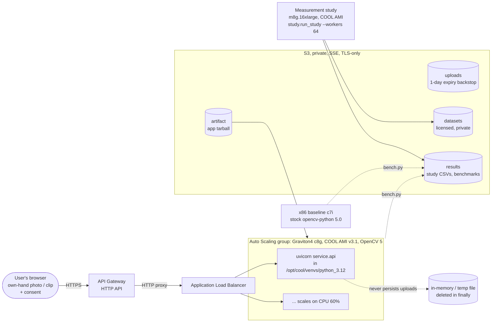
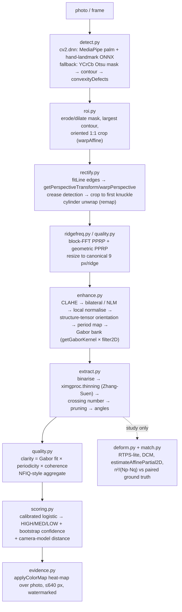
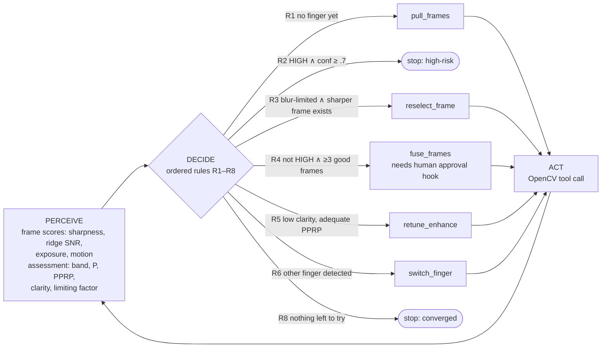

# Architecture

> GATTACA is a privacy-awareness tool. It estimates exposure risk; it does not store biometrics or defeat security systems.

## 1. System on AWS (OpenCV 5 + COOL on Graviton)



| Component | AWS service | Why |
|---|---|---|
| Public endpoint judges can hit | API Gateway HTTP API → ALB | Stable HTTPS URL. Proxies `/`, `/api/score`, `/api/protect`, `/health` |
| **Core OpenCV workload** | **EC2 Auto Scaling, Graviton4 (c8g), COOL AMI** | COOL ships as an AMI (OpenCV 5 + Arm/KleidiCV optimisations). Detection, enhancement, Gabor bank, ECC alignment, fusion and the agent all run in the COOL `cv2` |
| Measurement study | One large Graviton COOL instance (`--workers = vCPUs`) | Probe × condition is embarrassingly parallel. `ProcessPoolExecutor` fans it out over all cores |
| Storage | S3 (uploads / datasets / results / artifact) | Uploads have a 1-day expiry backstop. The service itself never writes uploads anywhere |
| x86 baseline | EC2 c7i + stock `opencv-contrib-python-headless==5.0.0.93` | Same `bench.py`, for the COOL comparison |

**x86 ↔ Arm.** Everything is pure Python plus wheels that exist for both `manylinux_x86_64` and `aarch64`, so the same code and the same `Dockerfile` run on either. COOL adds Arm-specific kernels underneath `cv2` without any API change, so no GATTACA code is architecture-specific. `bootstrap_cool.sh` installs our dependencies into the COOL venv *without* OpenCV or numpy, so COOL's `cv2` keeps serving (proof captured in `cool_build_info.txt` and in every `bench.py` result: `cv2.__file__`, `sys.prefix`, KleidiCV flag, instance type from IMDS). Serverless (Lambda/Fargate) was considered for `/score`. It was rejected for the core path because COOL is AMI-only, and a warm process keeps the ONNX models and the synthetic cache loaded.

Deploy: `aws/infra` (CDK). Benchmark: `aws/cool_benchmark` (see its README).

## 2. OpenCV 5 pipeline



Video path: `decode.py` (VideoCapture) → `track.py` (`calcOpticalFlowPyrLK` with forward-backward check) → `select.py` (Laplacian sharpness, ridge SNR, exposure, motion) → `align.py` (`findTransformECC`, ORB + `estimateAffinePartial2D` fallback) → `fuse.py` (2× kernel-regression splatting + robustness weights).

## 3. Agent workflow (Agentic Vision)



The agent's goal is the **worst-case** exposure: the estimate is the maximum over everything a motivated adversary could try. Every decision is logged with the rule ID, the measured values that triggered it and the change in the estimate it produced. Verbatim trace (`python -m gattaca demo`, shipped calibration, synthetic 24-frame handheld clip at ~3.8 px/ridge):

```
[R1] pull_frames     because no frames decoded yet
    -> LOW    P=0.154 clarity=0.109 pprp=3.83   (best so far 0.154)
[R4] fuse_frames     because band LOW with 6 usable frames; fusion can add sub-pixel detail
    -> MEDIUM P=0.561 clarity=0.238 pprp=3.83   (best so far 0.561, delta +0.407)
[R5] retune_enhance  because clarity 0.238 at adequate PPRP 3.83
    -> LOW    P=0.031 clarity=0.017             (best so far 0.561, delta +0.0)
[R5] retune_enhance  because clarity 0.017 at adequate PPRP 3.83
    -> LOW    P=0.23  clarity=0.128             (best so far 0.561, delta +0.0)
[R8] stop            because no remaining action is expected to raise the estimate
```

The LOW band measured on the best single frame caused the fusion call (R4). The fused result's low clarity at adequate resolution caused the enhancement retunes (R5). Each vision output changed the next tool call, and the trace records the numbers that did it. On an easier clip with sharp frames, the same agent stops after one step (`[R1] → HIGH → [R2] stop`), so it does not spend compute it doesn't need.

Task-level evaluation (`tests/test_video_agent.py`): early stop on an easy clip (R1→R2); fusion triggered on a borderline clip; fusion beats the best single frame on ≥2 of 3 synthetic clips (matched minutiae vs ground truth roughly double at ~3.1 px/ridge); human declines and allow-lists are honoured.

**Human control:** `AgentConfig.frame_budget`, `max_steps`, `allowed` (action allow-list), `approve(action, ctx)` (consulted before fusion, the expensive step) and `on_step(entry)` (return `False` to abort). The tests cover a declined approval and a restricted allow-list.
